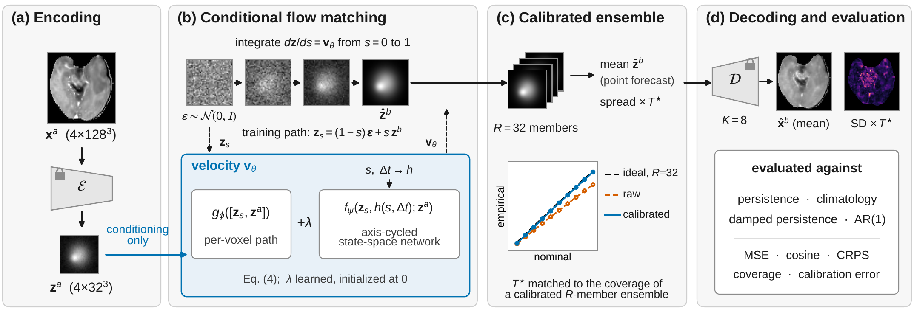

# Bio-SSM-Flow

**Calibrated Probabilistic Forecasting of Post-Treatment Glioma MRI with State-Space Flow Matching**

---

## Overview

Bio-SSM-Flow forecasts how a patient's next follow-up MRI is likely to appear after glioma treatment, and returns a calibrated, voxel-wise estimate of the forecast's uncertainty. Its purpose is to support the interpretation of follow-up imaging, for example in response assessment, by providing a patient-specific expectation; it does not perform response assessment itself.

<p align="center">
  
</p>

The method has three components:

- **Conditional flow matching in latent space.** Gaussian noise is transported to the follow-up latent of a frozen 3-D VQGAN; the baseline scan enters only as a conditioning input and never as an endpoint of the transport path.
- **An axis-cycled state-space velocity network.** A per-voxel path is combined with a state-space network whose cost is linear in the number of latent tokens, making whole-brain generation tractable.
- **Ensemble calibration.** A single temperature, cross-fitted across patients, rescales the spread of a 32-member ensemble to the coverage attainable by a calibrated finite ensemble.

The model is evaluated as a forecasting system: against persistence, climatology, damped persistence, voxel-wise autoregression, a probabilistic regressor with the same network, and a diffusion model with the same backbone, with five-fold cross-validation on LUMIERE and a **pre-specified external validation** on UCSF-ALPTDG and MU-Glioma-Post.

## Main results

Tumor-region results on the development cohort (LUMIERE, 81 patients, five-fold cross-validation; patient-level means):

| Forecaster | Tumor-region MSE | Tumor-region CRPS | Calibration error |
| --- | --- | --- | --- |
| Persistence | 2.187 | – | – |
| Damped persistence | 1.456 | 0.658 | 0.0126 |
| Voxel-wise AR(1) | 1.477 | 0.661 | 0.0074 |
| Probabilistic regressor (same network) | 1.434 | 0.651 | 0.0137 |
| Diffusion (same backbone) | 1.428 | 0.636 | 0.0136 |
| **Bio-SSM-Flow** | **1.413** | **0.632** | 0.0142 |

- Damped persistence alone recovers about 94% of the apparent improvement over persistence; Bio-SSM-Flow reduces tumor-region error by a further 3.0% relative to damped persistence and 4.3% relative to AR(1).
- Temperature scaling reduces calibration error by 87% and is required for Bio-SSM-Flow to outperform the statistical forecasts probabilistically.
- In the pre-specified external validation, five of six primary hypotheses were confirmed. Where follow-up scans were co-registered within patients (UCSF-ALPTDG), persistence remained the strongest forecaster, and the transferred temperature over-dispersed the forecasts.

See the paper for confidence intervals, statistical tests, and the full analysis.

## Pre-specified external validation

The external analysis plan, the evaluation code, the hashes of the frozen models, and the patient-to-model assignment were committed **before any external forecast was computed**:

- **Freeze commit:** `9ace113` (tag `ext-validation-freeze`)
- **Analysis plan:** [`EXTERNAL_VALIDATION_PLAN_v1.0.md`](EXTERNAL_VALIDATION_PLAN_v1.0.md); earlier drafts (v0.1–v0.4) are kept for transparency.

To inspect the freeze:

```bash
git show --stat ext-validation-freeze        # files frozen and the commit date
git diff ext-validation-freeze -- eval_external.py EXTERNAL_VALIDATION_PLAN_v1.0.md   # empty: unchanged since the freeze
```

The evaluation script refuses to run on external data without the freeze commit (`--plan_commit`), and verifies the SHA-256 hashes of all frozen artifacts before computing any forecast.

## Repository structure

| File | Purpose |
| --- | --- |
| `cache_latents.py`, `cached_pair_dataset.py`, `lumiere_dataset.py`, `transforms.py` | LUMIERE preprocessing, latent caching, scan pairs, and patient-level folds |
| `vqgan3d.py` | Frozen 3-D VQGAN (encoder and decoder) |
| `velocity_net_v2.py`, `flow.py`, `metrics.py` | Velocity network, flow-matching objectives, CRPS and related metrics |
| `train.py`, `train_ddpm.py` | Training of Bio-SSM-Flow and of the diffusion comparator |
| `eval_unified.py` | Internal evaluation (ensembles, calibration arrays, per-pair metrics) |
| `baseline_ar1.py` | Persistence, climatology, damped persistence, AR(1), linear extrapolation |
| `baseline_probreg.py` | Probabilistic regressor with the same network and likelihood |
| `aggregate_unified.py`, `make_table2.py` | Cross-fitted calibration, patient-level statistics, Table II |
| `ablate_unified.py` | Ablations of the state-space branch and of the interval conditioning (Table III) |
| `ingest_alptdg.py`, `ingest_mu.py` | External cohorts: eligibility, label harmonization, registration, quality control |
| `eval_external.py` | Frozen external evaluation and its pre-specified statistics (Table IV) |
| `plot_fig2_calibration.py`, `plot_fig3_skill.py`, `plot_fig4_qualitative.py` | Figures, generated from saved results |
| `EXTERNAL_VALIDATION_PLAN_*.md` | Pre-specified analysis plan and its drafts |

## Installation

Tested on Ubuntu with Python 3.10, PyTorch 2.5.1, and CUDA 12 on an NVIDIA RTX 5880 Ada (48 GB).

```bash
git clone https://github.com/ekwadwo1/Bio-SSM-Flow.git
cd Bio-SSM-Flow
conda env create -f environment.yml        # or: pip install -r requirements.txt
conda activate er_diff
```

The state-space network requires the `mamba-ssm` CUDA kernels; external-cohort registration uses `antspyx`.

## Data

**No patient data are included in this repository.** The three datasets are publicly available from their providers; please follow each provider's terms of use:

| Dataset | Role | Source |
| --- | --- | --- |
| LUMIERE | Development (81 patients, 469 scan pairs) | Suter *et al.*, *Scientific Data*, 2022 |
| UCSF-ALPTDG | External validation (292 patients) | Fields *et al.*, *Radiology: Artificial Intelligence*, 2024 |
| MU-Glioma-Post | External validation (149 patients, 371 scan pairs) | The Cancer Imaging Archive, 2025 |

Before running the scripts, set the data and checkpoint paths at the top of `cache_latents.py`, `eval_unified.py`, `ingest_alptdg.py`, and `ingest_mu.py`.

## Usage

Commands are run from the repository root. Each script accepts `--help` for its full set of options.

**1. Encode the development cohort**

```bash
python cache_latents.py
```

**2. Train and evaluate (five folds)**

```bash
python train.py --fold 0                      # repeat for folds 0-4
python eval_unified.py --transport flow
python eval_unified.py --transport ddpm       # diffusion comparator (after train_ddpm.py)
python baseline_ar1.py                        # statistical reference forecasts
```

**3. Aggregate and test (Table II)**

```bash
python aggregate_unified.py --runs runs/eval_unified/flow runs/eval_unified/ar1 --names Bio-SSM-Flow AR1
python make_table2.py
```

**4. Ablations and the probabilistic regressor (Table III)**

```bash
python ablate_unified.py eval --variant ssm_off --folds 0 1 2 3 4
python ablate_unified.py summary
python baseline_probreg.py train --fold 0     # repeat for folds 0-4
python baseline_probreg.py eval
python baseline_probreg.py compare
```

**5. External validation (Table IV)**

```bash
python ingest_alptdg.py
python ingest_mu.py
python eval_external.py --cohort alptdg --plan_commit 9ace1138d97ce8f19ca498c0d4c53d0627054b63
python eval_external.py --cohort mu     --plan_commit 9ace1138d97ce8f19ca498c0d4c53d0627054b63
python eval_external.py --summarize
```

**6. Figures**

```bash
python plot_fig_intro.py
python plot_fig1_overview.py
python plot_fig2_calibration.py
python plot_fig3_skill.py
python plot_fig4_qualitative.py
```

## Pretrained models

The five frozen fold models used in the paper are attached to the [GitHub release](https://github.com/ekwadwo1/Bio-SSM-Flow/releases). 


## Acknowledgments

We thank the investigators who collected and publicly shared the LUMIERE, UCSF-ALPTDG, and MU-Glioma-Post datasets, and The Cancer Imaging Archive for hosting MU-Glioma-Post. 
